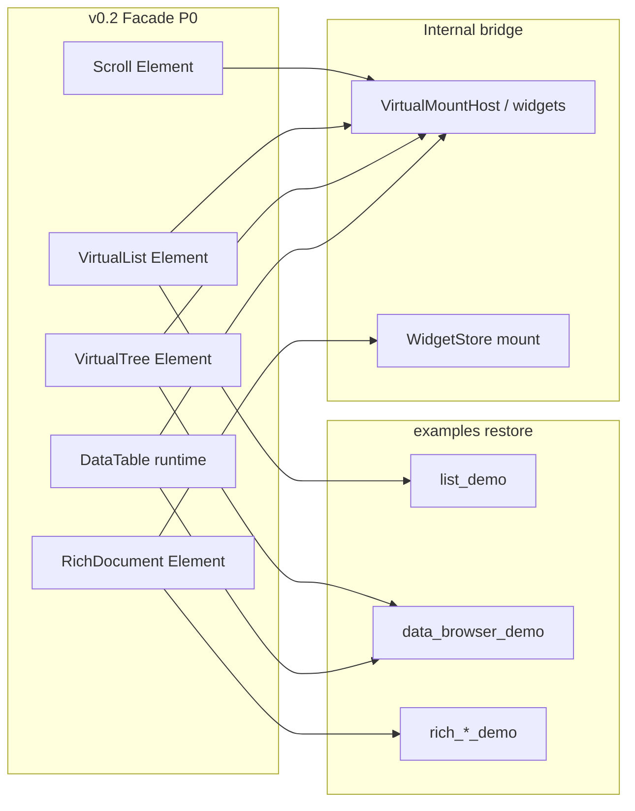

# SynUI 范例缺口分析与下一步任务清单

> 日期：2026-08-04  
> 范围：`examples/`（v0.2 facade）；in-tree v0.1 金标树已于 Phase 52 物理删除  

> 约束：**无兼容性负担**；遵守 Phase 24/25+ 硬锁（完整 CSS cascade、任意子树自动虚化、浮动 dock、RichEdit OT/HTML、服务端透视等仍不做）

---

## 1. 结论（先看这个）

当前主路径已是 **v0.2 curated facade**（`App` / `State` / `Action` / `Node` / `Element`）。Wave A–R 已把 Scroll/List/Table/Tree/Split/Tab/Rich/Nav/overlays/Icon/Image/Menu 迁回 `examples/`，完成质量门禁、正式 v0.3、金标树删除，Switch/Radio/Progress/Card/ListItem/TextArea/`Lottie`/`MorphingShape` 进 prelude，gallery sticky/fixed + `with_lottie`/`from_asset` 冒烟（Animation 分类 `playing(true)`），CircularProgress 确定弧、受控输入焦点保护、Label ghost（变长触布局脏），Wave Q 文本 geometry/paint cache 硬化与 Lottie Composition 预解析共享，以及 Wave R 软收口 + [硬锁签核包](hard_lock_signoff.md)。普通证据只认 `examples/*` + facade 门禁。Rust 应用用 `prelude`；非 Rust 用 Production ABI `synui-abi` v1.1（本阶段不扩 ABI）。

| 层 | 现状 | 范例可用性 |
|----|------|------------|
| **v0.2 prelude** | 输入（含 Switch/Radio/TextArea）+ Linear/CircularProgress + Lottie/MorphingShape + Card/ListItem + Scroll/List/Table/Tree/Split/Tab + RichDocument + 导航/overlays + Icon/Image/Label + in-app MenuBar/ContextMenu | Wave A–R demos OK |
| **legacy feature** | **已删除（Phase 51 / v0.3）** | 不再可编译；金标树已删（Phase 52） |
| **缺口** | Wave R 签核包已交付；下一实现极 = **产品勾选后的首项硬锁**（建议 Cascade v3，以签核表为准） | — |

**产品建议（Wave R 收口后）：** 用 [`hard_lock_signoff.md`](hard_lock_signoff.md) 勾选后才开实现波；未勾选不得实现硬锁；不恢复金标树；不默认扩 ABI。

---

## 2. 范例对比矩阵（能力差距）

LOC 为各 demo 下全部 `.rs` 合计（约值）。**状态**：`完整` = 接近 old 交互；`壳` = 有模型/Action 但 UI 为 Button/Node 占位；`描述符` = `external-element` 边界。

| Demo | new LOC | old LOC | 新范例状态 | Old 有而 New 缺失/弱化 | New 新增 |
|------|---------|---------|------------|------------------------|----------|
| **widget_gallery** | — | — | **已删除（Phase 52）** | 历史 Engine 金标 | 见 DEVELOPMENT Phase 52 |
| **widget_gallery_facade** | 有 | 无 | facade 橱窗（子集） | — | TextArea + sticky/fixed（Wave N）；prelude Lottie/Morph + `with_lottie`（Wave P）；Animation `playing(true)` + Dialog/Sheet 居中（Wave R） |
| **data_browser_demo** | — | ~594 | **完整（Wave B+C+F）** | dock（硬锁） | Tree+Split+Tab+Table+RichDocument+MenuBar+filter |
| **list_demo** | ~45 | ~102 | **完整（Wave D）** | — | prelude `VirtualList` 10k + MenuBar/ContextMenu |
| **tree_list_demo** | — | ~215 | **完整（Wave D）** | — | prelude `VirtualTree` + `VirtualList` + menus |
| **table_demo** | — | ~123 | **完整（Wave B+I）** | 服务端透视；编辑合并 UI | 真虚滚+排序/选中/编辑+filter+声明式 merge spans |
| **navigation_demo** | — | ~134 | **完整（Wave C+F）** | platform history 深度 | AppBar+Drawer+BottomNav+Dialog+MenuBar |
| **style_demo** | ~130 | ~63 | **完整（MVP / Wave G）** | Cascade v3（硬锁） | prelude `Styled` grid/flex/absolute + StyleCache |
| **style_sticky_demo** | ~100 | ~86 | **完整（Wave A；gallery 冒烟子集 Wave N）** | 完整套件仍属本 demo | prelude `Scroll` + `Styled` sticky/fixed；见 `style_sticky_demo` |
| **rich_edit_demo** | — | ~94 | **完整（Wave C）** | OT/HTML/嵌套表 | prelude `RichDocument` + MD export |
| **rich_blocks_demo** | — | ~137 | **完整（Wave C）** | OT/HTML/嵌套表 | 真宿主块编辑 + MD 往返 |
| **todo_list** | ~120 | ~147 | **完整（Wave A）** | File-menu import（平台边界） | prelude `Scroll` + toggle/delete |
| **counter** | ~32 | ~50 | 完整（简化） | — | facade 样板 |
| **multi_window_demo** | ~55 | ~80 | **完整（MVP / Wave G）** | tray（host 边界） | `Window::with_second_window` + 共享 State |
| **show_image** | — | ~38 | **完整（Wave C）** | — | prelude `Image` + `Window::with_image` |

**Phase 43 Wave A 已收口：** `list_demo` / `todo_list` / `style_sticky_demo` 使用 prelude `VirtualList` / `Scroll` / `Styled`，不再出现 `external-element` 占位。

**Phase 44 Wave B 已收口：** `table_demo` / `tree_list_demo` / `data_browser_demo` 使用 prelude `DataTable` / `VirtualTree` / `SplitPane` / `TabBar`。

**Phase 45 Wave C 已收口：** `rich_edit_demo` / `rich_blocks_demo` / `navigation_demo` / `show_image`；`data_browser` Preview → `RichDocument`。

**Phase 46 Wave D 已收口：** in-app `MenuBar`/`ContextMenu` 进 prelude；`list_demo`/`tree_list_demo` 菜单 checklist；[`gallery_facade_vs_engine.md`](gallery_facade_vs_engine.md)；`examples_old` 退役门槛已写清。

**Phase 47 Wave F 已收口：** `navigation_demo` / `data_browser_demo` MenuBar；facade gallery 冒烟扩面；D5 执行 `examples_old` → 金标档案（Phase 52 已删）。dock / Cascade v3 / OT 继续硬锁。

**Phase 48 Wave G 已收口：** prelude `Label`；`multi_window_demo` 第二窗共享 State；`style_demo` Styled MVP；gallery VirtualTree/SplitPane/Image 冒烟；v0.3 retirement **准备清单**（未砍 `legacy`）。

---

## 3. Pub API 缺口（相对 demo 需求）

### 3.1 v0.2 已有（可保留并加深）

- `App` / `AppContext` / `State` / `Action` / `Model`
- `Node`：`text` / `row` / `column` / `boxed` / `key`
- 输入：`Button`、`TextInput`、`Checkbox`、`NumberInput`、`Select`
- **Phase 43：** `Scroll`、`VirtualList`、`Styled`（sticky/fixed 元数据）
- **Phase 44：** 运行时 `DataTable`/`TableColumn`、`VirtualTree`/`TreeNode`、`SplitPane`/`SplitDirection`、`TabBar`；`VirtualDataTableModel` 仍可用于请求窗
- **Phase 45：** `RichDocument`（prelude `BlockDoc`）、导航 chrome、overlays、`Icon`/`Image`；`Window::with_image`
- **Phase 46：** in-app `MenuBar`/`ContextMenu`/`Menu`/`MenuItem`；`VirtualList::on_context`
- `Style` / `StyleCache` / 诊断（非 panic）
- `platform::{Window, RunLoop}`

### 3.2 缺一等公民 Element（P0 → Wave D 已交付）

| 建议 API（名称可调整） | 对标 legacy / widgets | 解锁 demo |
|------------------------|----------------------|-----------|
| ~~`Scroll`~~ | ~~已交付 Phase 43~~ | style_sticky、todo |
| ~~`VirtualList`~~ | ~~已交付 Phase 43~~ | list_demo |
| ~~`VirtualTree`~~ | ~~已交付 Phase 44~~ | tree_list_demo、data_browser |
| ~~`DataTable` 运行时~~ | ~~已交付 Phase 44~~ | table_demo、data_browser |
| ~~`SplitPane` / `TabBar`~~ | ~~已交付 Phase 44~~ | data_browser |
| ~~`RichDocument`~~ | ~~已交付 Phase 45~~ | rich_edit、rich_blocks、data_browser Preview |
| ~~`AppBar` / `Drawer` / `BottomNav` / overlays~~ | ~~已交付 Phase 45~~ | navigation_demo |
| ~~`Icon` / `Image`~~ | ~~已交付 Phase 45~~ | show_image |
| ~~`MenuBar` / `ContextMenu`~~ | ~~已交付 Phase 46（in-app Element）~~ | list_demo、tree_list_demo |

实现约束（硬锁内）：

- 虚滚 = **行模板 / 显式 slot**，禁止任意 flex/grid 自动扫描
- 过滤 = 客户端 MVP（子串/简单算子），不做服务端透视/正则引擎
- RichEdit = 跨块选区可做；嵌套表/HTML/OT → 继续 Phase 25+ 锁
- 菜单 = prelude **in-app** overlay；`DesktopMenu`/muda = platform shell；GTK 真菜单继续硬锁

### 3.3 P1（剩余壳层 / DX）

| API | 对标 | 解锁 |
|-----|------|------|
| `Label`（无障碍/截断） | 超越裸 `Node::text` | **Phase 48+50 已交付**（line-budget + paint-width ellipsis） |

### 3.4 P2 / 明确不做（本阶段）

- 完整 CSS cascade / selectors / `!important`
- 浮动 dock / 撕标签 / 跨窗 pane
- 把 muda 提升为唯一菜单 API / GTK 真菜单
- 插件 CDN、cold `layout_10k` ≤8ms 门禁
- 恢复已删金标树；硬锁能力（见上）仍需签核
- 把完整 sticky/z-index 套件从 `style_sticky_demo` 迁走（gallery 仅 smoke）
- ~~Lottie / MorphingShape 进 prelude~~（**Phase 57 已交付**）
- ~~`Window::with_lottie` 预加载；Label ghost（facade 变长 layout dirty）~~（**Phase 57 已交付**）

### 3.5 Legacy 侧小缺口（若短期仍用 gallery）

Fluent 缺失、需 `register_*` 的绑定：`Selection` / `TreeSelection` / `Tab` / `SplitRatio` / `ColumnLayout` / `TableFilter`。  
**建议：** 不在 legacy 上继续堆 fluent；把精力放在 facade Action 等价物。

---

## 4. 架构建议（下一步怎么做）



**原则：**

1. **Facade Element 是稳定 API**；内部可调用 `synui-widgets` + Phase 24 `VirtualMountHost`，对应用隐藏 `WidgetId`/`ViewEngine`。
2. **交互一律 `Action`/`State`/`Model`**，避免 `take_*_dirty` 轮询成为应用代码。
3. **每个 Element 交付时同步改一个 demo**（定义 of done = old 交互 checklist 勾满）。
4. 金标树已于 Phase 52 删除；普通证据只认 `examples/*` + facade 门禁。

---

## 5. 任务清单（可执行）

### Wave A — 虚滚与滚动（最高优先级）

- [x] **A1** 设计并实现 `synui::widgets::Scroll`（offset、clip、可选 sticky 元数据；滚轮 chaining 对齐 Phase 24）
- [x] **A2** 实现 `VirtualList`：`row_count`、可见窗、`item` builder（或 `Action` 请求行描述）、选中/激活 Action
- [x] **A3** 内部接入 `ListView`/`ScrollView` + `sync_virtual_mounts`；10k 挂载 ≤~40 测试迁到 facade 层
- [x] **A4** 恢复 `examples/list_demo`：真滚动 + 选中 +（可选）平台 ContextMenu；去掉 `external-element` 假属性
- [x] **A5** 恢复 `examples/style_sticky_demo`：真 sticky 条 + 可滚内容
- [x] **A6** 恢复 `examples/todo_list`：可滚列表而非 Button 列

### Wave B — 表格与浏览器壳

- [x] **B1** 扩展 facade `DataTable`：过滤查询、列宽/顺序变更、单元格编辑、选区 → typed Actions（对接现有 `VirtualDataTableModel`）
- [x] **B2** 实现 `VirtualTree`：展开/折叠、选中、激活；挂载窗与 a11y `row_count`
- [x] **B3** 实现 `SplitPane` + `TabBar` Elements（固定树，非 dock）
- [x] **B4** 恢复 `examples/table_demo`：虚滚表 + 排序/编辑（合并格可选）
- [x] **B5** 恢复 `examples/data_browser_demo`：Tree | Split(V, Tabbed Table/Preview | Detail) + filter；对照 `examples_old` checklist
- [x] **B6** 恢复 `examples/tree_list_demo`

### Wave C — 文档编辑与导航

- [x] **C1** `RichDocument` Element：`BlockDoc` 双向、焦点/选区、基础快捷键（跨块选区优先；无 HTML/OT）
- [x] **C2** 恢复 `rich_edit_demo` / `rich_blocks_demo`
- [x] **C3** `AppBar` / `Drawer` / `BottomNav` / overlays → 恢复 `navigation_demo`
- [x] **C4** `Icon`/`Image` Element → `show_image` / gallery facade 媒体段

### Wave D — 平台与 DX

- [x] **D1** 菜单策略定稿：prelude **in-app** `MenuBar`/`ContextMenu`；`DesktopMenu`/muda = platform shell
- [x] **D2** 更新 `docs/migration-v0.2.md`：Wave A–D 交付表
- [x] **D3** `widget_gallery_facade` 与 Engine `widget_gallery` 能力对照表（[`gallery_facade_vs_engine.md`](gallery_facade_vs_engine.md)）+ facade gallery 冒烟
- [x] **D4** `CURATED_EXPORT_INDEX` / rustdoc 示例与 Wave A–D Element 同步
- [x] **D5** 约定退役门槛（Phase 46 写清；Phase 47 执行 rename）

### Wave E — 质量门槛（每 Wave 附带）

- [x] **E1** MenuBar/ContextMenu：挂载 + Action 烟测；list/tree demo checklist
- [x] **E2** a11y：List/Grid `row_count` 既有测不回退（`facade_scroll_and_virtual_list_*` / DataTable bound）
- [x] **E3** 非目标写明：无 cascade / dock / OT（Phase 46 notes）

### Wave F — 迁移收口（Phase 47）

- [x] **F1** 清掉过时「菜单 N/A (Wave D)」文案
- [x] **F2** `navigation_demo` / `data_browser_demo` MenuBar
- [x] **F3** `widget_gallery_facade` 冒烟扩面 + 对照表更新
- [x] **F4** D5 执行：`examples_old` → 金标档案（后于 Phase 52 删除）
- [x] **F5** Phase 47 notes + 硬锁复述（Phase 48+）

### Wave G — Facade DX 打磨（Phase 48）

- [x] **G1** prelude `Label` Element + 挂载烟测 + CURATED/api-reference/manifest
- [x] **G2** `multi_window_demo`：`Window::with_second_window` + 共享 State（tray 仍 host 边界）
- [x] **G3** `style_demo`：prelude `Styled` grid/flex/absolute MVP + StyleCache 诊断
- [x] **G4** `widget_gallery_facade` VirtualTree/SplitPane/Image 冒烟 + 对照表
- [x] **G5** Phase 48 notes + v0.3 retirement prep 清单（未砍 `legacy`）

### D5 — 退役门槛（Phase 47 已执行）

1. [x] Wave A–D（+ F2）对应 `examples/*` checklist 勾满（无 N/A 菜单占位；dock 仍硬锁）。
2. [x] `cargo check` 冒烟覆盖 list/tree/table/data_browser/rich_*/navigation/show_image/widget_gallery_facade。
3. [x] Menu Action 烟测通过。
4. [x] List/Grid a11y bound 测不回归。
5. [x] 显式清理：Phase 47 rename 金标档案；**Phase 52** 物理删除（非 ordinary facade 证据）。

---

## 6. 建议排期与产品极

| 阶段 | 主题 | 验收 |
|------|------|------|
| **Wave A（已交付）** | Scroll + VirtualList 进 prelude，list/todo/sticky 恢复 | 10k 真虚滚可点可选；无 external-element 糊 |
| **Wave B（已交付）** | Table/Tree/Split/Tab + data_browser | 对照 old：分栏+过滤+文本预览可演示 |
| **Wave C（已交付）** | RichDocument + 导航 chrome + overlays + Icon/Image | rich_* / navigation / show_image 去掉占位 |
| **Wave D–E（已交付）** | 菜单策略、gallery facade、old 退役门槛 | 默认 `cargo run -p *` 菜单可点 |
| **Wave F（已交付）** | 迁移收口、gallery 扩面、金标 rename | D5 rename；workspace MenuBar 诚实 |
| **Wave G（已交付）** | Label / multi_window / style_demo / gallery 冒烟 / v0.3 prep 清单 | DEVELOPMENT Phase 48 notes |
| **Wave H（已交付）** | 质量门禁 + v0.3 prep 执行（审计/CI；不砍 legacy） | DEVELOPMENT Phase 49 notes |
| **Wave I（已交付）** | 质量门禁续作（CI 回归 / Slider 冒烟 / Label ellipsis / merge spans） | DEVELOPMENT Phase 50 notes |
| **Wave J（已交付）** | 正式 v0.3：删除 `legacy` feature；Conditional→Removed；gallery/hosts 迁入金标树 | DEVELOPMENT Phase 51 notes |
| **Wave K（已交付）** | 物理删除金标树；清死链；checklist §6 | DEVELOPMENT Phase 52 notes |
| **Wave L（已交付）** | Facade DX：死命令清扫 + Switch/Radio/LinearProgress prelude | DEVELOPMENT Phase 53 notes |
| **Wave M（已交付）** | Facade DX：Card/ListItem/CircularProgress prelude + gap hygiene | DEVELOPMENT Phase 54 notes |
| **Wave N（已交付）** | Facade DX：TextArea prelude + gallery sticky/fixed 解冻 | DEVELOPMENT Phase 55 notes |
| **Wave O（已交付）** | 质量：CircularProgress 弧 + 焦点保护；advanced Lottie/Morph | DEVELOPMENT Phase 56 notes |
| **Wave P（已交付）** | Label ghost + `Window::with_lottie` + Lottie/Morph prelude | DEVELOPMENT Phase 57 notes |
| **Wave Q（已交付）** | 软质量：text geometry/paint cache + Lottie Composition 共享 | DEVELOPMENT Phase 58 notes |
| **Wave R（已交付）** | 软收口（gallery playing / Dialog·BottomSheet 居中）+ [硬锁签核包](hard_lock_signoff.md) | DEVELOPMENT Phase 59 notes |
| **下一迭代** | 产品勾选后的首项硬锁实现（建议 Cascade v3） | [`hard_lock_signoff.md`](hard_lock_signoff.md)；未勾选禁止开工 |

**已选定产品极（Wave A–R）：**  
**「… → 软收口 + 硬锁签核包」**；硬锁实现仍需产品在签核表勾选。

---

## 7. 参考路径

| 材料 | 路径 |
|------|------|
| 新范例 | [`examples/`](../examples/) |
| 旧范例（金标） | **已删除（Phase 52）**；见 DEVELOPMENT Phase 52 notes |
| Facade 根 | [`crates/synui/src/lib.rs`](../crates/synui/src/lib.rs) |
| Facade 控件 | [`crates/synui/src/widgets.rs`](../crates/synui/src/widgets.rs) |
| Legacy View（历史） | **已删除**（Phase 51 去 feature；Phase 52 去金标树） |
| 虚滚宿主 | [`crates/synui-widgets/src/virtual_mount.rs`](../crates/synui-widgets/src/virtual_mount.rs) |
| 迁移说明 | [`docs/migration-v0.2.md`](migration-v0.2.md) |
| 阶段硬锁 | [`docs/DEVELOPMENT.md`](DEVELOPMENT.md) Phase 24/25+ |

---

## 8. Wave H0 / I 手测 / 回归门禁（Phase 49–50）

单测过滤（必须绿；CI：`python3 scripts/migration_gate.py --facade-regression`）：

```bash
cargo test -p synui-widgets --lib open_drawer_overlay
cargo test -p synui --lib navigation_drawer_overlay
cargo test -p synui-widgets --lib grid_three_equal_columns
cargo test -p synui-widgets --lib single_click_places_caret
cargo test -p synui-widgets --lib double_click_word_selection
cargo test -p synui-render --lib ascii_caret_x
cargo test -p synui --lib label_text_change_marks_layout
cargo test -p synui --lib facade_label_length_change_marks_layout
cargo test -p synui --lib facade_label_same_length_text_stays_paint
cargo test -p synui-widgets --lib slider_rejects_flex_shrink
cargo test -p synui --lib facade_number_input_drag_grabs_pointer
cargo test -p synui --lib facade_label_truncates_to_paint_width
cargo test -p synui --lib facade_data_table_applies_merge_spans
cargo test -p synui-render --lib fit_text_with_ellipsis
cargo test -p synui-render --lib measure_does_not_populate_paint_cache
cargo test -p synui-render --lib dark_on_surface_paint_uses_light_brush
```

| Demo 手测 | 通过标准 |
|-----------|----------|
| `navigation_demo` | AppBar **Drawer** 打开左侧轨可见 List/Settings；点遮罩关闭；File/Help 仍为紧凑 MenuBar |
| `style_demo` | 「CSS Grid 3 columns」下 A/B/C **同行三等分**，均在窗口内 |
| `rich_edit_demo` | Export MD / Load sample 行高紧凑（非半屏空白）；**单击**落光标可编辑；**双击**选词且不立刻消失 |
| `todo_list` | 英文输入时光标贴在字后（不随长度漂移） |
| `counter` | 连点跨位数（9→10）无旧数字残影（含 facade Label 变长 layout dirty） |
| `widget_gallery_facade` | Volume 拖动滑块不消失；可滚到 BottomNav；非 Animation 分类无强制 60fps 闪烁；TextArea 可编；sticky/fixed 可见；CircularProgress 确定弧可见；`with_lottie` + `from_asset` Lottie/Morph 在 Animation 分类 `playing(true)` 可见运动；About Dialog / BottomSheet Close 水平居中 |

## 9. 立即下一步（建议）

1. Wave A–R 已收口（v0.3 + 金标删除 + prelude 含 Lottie/Morph + Label ghost + `with_lottie` + text/Lottie render DX + 软收口 + 硬锁签核包）。见 DEVELOPMENT Phase 51–59 notes。  
2. 硬锁（dock / Cascade v3 / OT / GTK 真菜单）仅在 [`hard_lock_signoff.md`](hard_lock_signoff.md) 对应项勾选后推进；签核包本身不等于批准开工。  
3. 下一实现极：**产品勾选后的首项**（建议顺序：Cascade v3 → dock → RichEdit OT/HTML → GTK 真菜单）。  
4. 语言边界：Rust → `synui::prelude`；非 Rust → `synui-abi` v1.1（不因本波硬锁讨论自动扩 ABI）。
